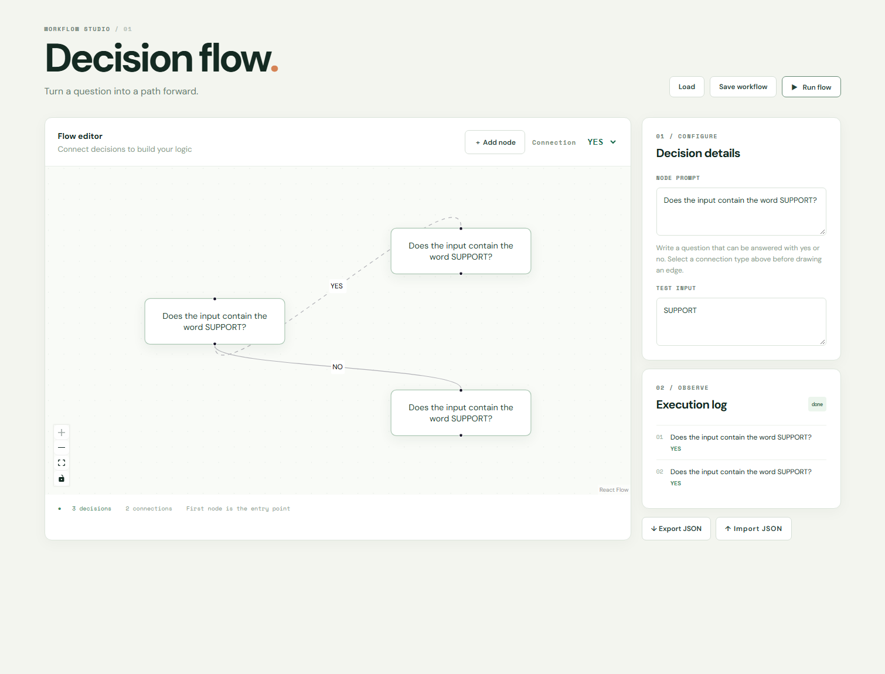
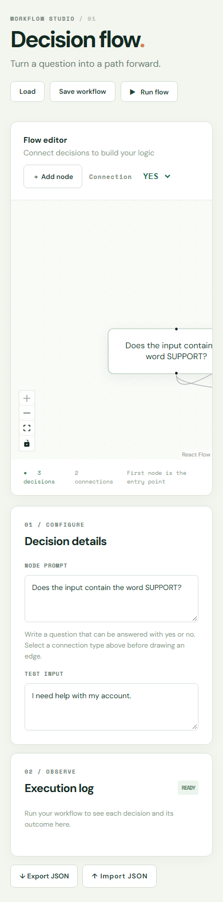

# AI Decision Flow rebuild

AI-assisted public reconstruction from the earlier implementation, begun 2026-11-05 with current timestamps and real phase checkpoints. The earlier repository is preserved. Four phases follow the supplied BE-09 assignment; implementation and verification details, including failed attempts, are in [BUILDLOG.md](BUILDLOG.md).

Requires Node 20.19+ and npm. Run `npm ci`, then copy `.env.example` to `.env`.

The checked configuration uses Ollama's OpenAI-compatible API at `http://127.0.0.1:11434/v1` with `gemma3:1b`. Install Ollama and run `ollama pull gemma3:1b`. The local placeholder API key is `ollama`. Alternatively use a real OpenAI API key, `OPENAI_BASE_URL=https://api.openai.com/v1` and an available model name. Credentials stay server-side in the ignored `.env`.

Start the Inngest development server in one terminal:

```sh
npx inngest-cli@latest dev --port 8389 --no-discovery -u http://127.0.0.1:8109/api/inngest
```

In another terminal run `npm run dev`. Open [the studio](http://localhost:5179) and [Inngest](http://localhost:8389). The API is on localhost:8109. `INNGEST_DEV=1` and `INNGEST_BASE_URL=http://127.0.0.1:8389` are required in this local configuration.

Add a decision, edit its prompt, choose YES or NO, then drag from a source handle to another node's target handle. One outgoing connection per answer is allowed. The first node is the entry point. Missing outcome connections finish that path; cycles stop with an error. Select nodes or edges and press Backspace to delete them.

Changes automatically persist as a local draft. Save workflow stores a separate snapshot; Load restores it. JSON import validates prompts, IDs, connections and positions; Export downloads the current graph. The included [verified-workflow.json](verified-workflow.json) is a working import example: run with `SUPPORT` for the YES branch or `SALES` for NO.

Run flow submits an asynchronous job (202). Each visited node executes as its own named Inngest step through the OpenAI SDK. A response must be exactly YES or NO after trimming; explanatory or other outputs fail rather than being guessed. The backend selects the matching edge and records the actual execution order. The studio shows status, the active node, traversed edges, ordered decisions and errors.

| API | Behavior |
|---|---|
| GET /api/health | 200 health |
| POST /api/runs | 202 run ID; 400 invalid graph/input; 503 unavailable workflow service |
| GET /api/runs/:id | Status, ordered log and errors; 404 unknown run |
| /api/inngest | Inngest SDK handler |

Run `npm test` for six branch/validation/engine tests and `npm run build` for production bundling. Actual Inngest and model branch outputs are in [phase3-verification.json](phase3-verification.json). Browser verification covered add/edit/connect, draft reload, save/load, import/export, invalid imports and a real run with two ordered YES decisions. No hosted deployment is claimed.





## Requirement checks

- [x] React, React Flow, official CLI-generated shadcn Button, Inngest and OpenAI SDK.
- [x] Add/connect/edit prompt nodes; YES/NO labels; local persistence.
- [x] Each visited node is a named Inngest step with strict binary model output and matching branch traversal.
- [x] Execution order and results tracked; actual YES and NO paths verified.
- [x] At least three enhancements: execution state, logs, save/load, import/export, styling, validation/errors and animated traversed edges.
- [x] Environment setup, public repo, four real implementation phases and fresh screenshots.

This is a local demonstration. Run-status data lives in API memory and is lost when the API restarts; Inngest step data is managed separately by its development server. The API is unauthenticated and should not be exposed publicly without access controls. Small local models can make incorrect decisions: the initial arithmetic smoke test returned NO for an even number; routing mechanics passed, but model factual accuracy is not guaranteed. The checked local provider is OpenAI-compatible Ollama, not a claim that paid OpenAI infrastructure was used. Inngest retries are configured, and an error status may be provisional while a retry runs.
